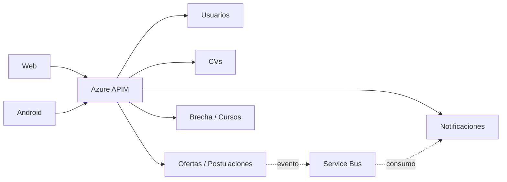

# Arquitectura CVExpert — índice de integración

> **Documento de coordinación, no la documentación final de arquitectura.** El responsable de la arquitectura detallada es Samuel y su aportación debe incorporarse por PR.

## Sistemas identificados

- Clientes: web y Android (Kotlin / Jetpack Compose).
- Punto de entrada único esperado: Azure API Management.
- Servicios: Usuarios; CVs; Ofertas/Postulaciones; Brecha/Cursos; Notificaciones.
- Mensajería: Azure Service Bus para eventos de notificación; SignalR para tiempo real; push y correo como canales.
- Persistencia distribuida por dominio según las decisiones del equipo; no se documentan aquí instancias reales sin evidencia de Azure.

**Validaciones pendientes:** rutas concretas, certificado cliente en cada backend, persistencia real por dominio, emisión de eventos desde otros servicios, estrategias de reintentos, FCM/correos/SignalR y despliegue final.
