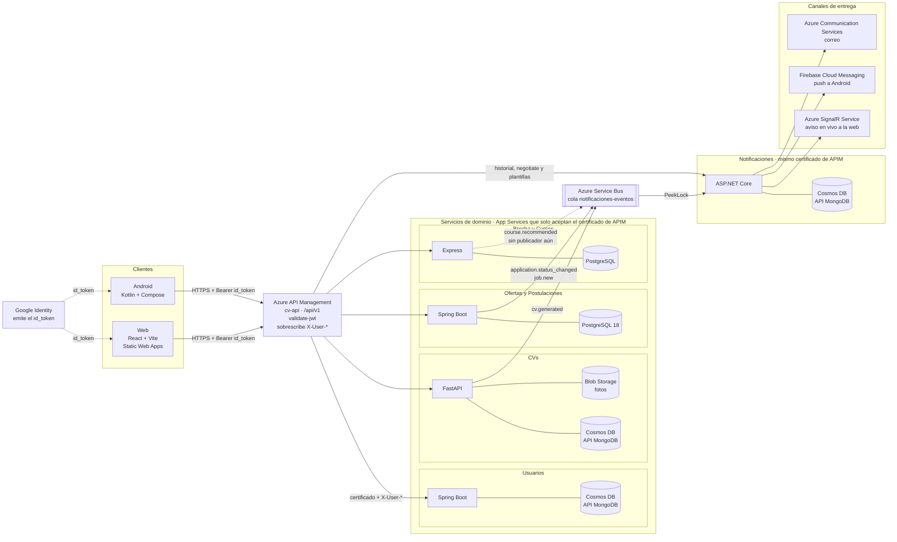

# Arquitectura de CVExpert

## Vista general

CVExpert ayuda a armar currículums, buscar ofertas con un porcentaje de compatibilidad, seguir postulaciones en un tablero y ver la brecha entre las habilidades propias y las del mercado. Hay dos clientes con la misma funcionalidad, una web en React y una app Android, y cinco microservicios, cada uno con su propio repositorio, su propia base de datos y su propio App Service.

Los clientes solo hablan con **Azure API Management (APIM)**. APIM valida el token de Google, agrega la identidad del usuario en encabezados y llama al backend presentando un certificado de cliente. Los backends no se llaman entre sí. Cuando un servicio tiene que avisarle algo al usuario, publica un evento en una cola de **Azure Service Bus**, y **Notificaciones** lo entrega por tiempo real, push y correo.

## Diagrama general

APIM llama a los cinco backends de la misma forma: presenta el certificado de cliente y sobrescribe los encabezados `X-User-*`. La web se conecta directo a Azure SignalR Service después de pedir el negotiate a Notificaciones por APIM. La línea punteada es la única parte incompleta: Brecha todavía no publica su evento. El diagrama no muestra las dependencias externas que no son de CVExpert: Gemini, que CVs usa para la IA de redacción, y JSearch, de donde Ofertas importa ofertas reales.

## Reglas del sistema

| Regla | Cómo se cumple en el código | Desviaciones encontradas |
| --- | --- | --- |
| **Ningún servicio llama a otro. Solo APIM llega a los backends, con certificado de cliente.** | Ningún backend tiene un cliente HTTP hacia otro servicio de CVExpert. Los únicos clientes HTTP salientes van a servicios externos: Gemini en CVs (`app/llm/gemini.py`) y JSearch en Ofertas (`JSearchJobSource`). Cada backend tiene un filtro que compara la huella del certificado reenviado en `X-ARR-ClientCert` (ver [seguridad](seguridad.md)). | En Usuarios el filtro está en la rama `certificado-swagger-postman`, todavía sin fusionar a `main`. CVs compara la huella pero no revisa la vigencia del certificado. |
| **Lo que un servicio necesita de otro dominio lo manda el cliente.** | Brecha recibe las habilidades del CV en `PUT /skills-gap/input` y las ofertas ya proyectadas por el cliente en `POST /skills-gap/evaluate`. Ofertas recibe el perfil de emparejamiento (habilidades, ubicación, modalidades) en `PUT /alerts`. Notificaciones recibe el idioma en `PUT /notifications/directory/me`, y el correo lo pone APIM desde el token. | Ninguna. |
| **Eventos por Service Bus hacia Notificaciones.** `application.status_changed` y `job.new` salen de Ofertas, `cv.generated` de CVs y `course.recommended` de Brecha. Usuarios no publica eventos. | Ofertas: `ServiceBusEventPublisher`. CVs: `app/events/service_bus.py`. Usuarios no tiene dependencia de Service Bus. El contrato está en [evento-notificacion.schema.json](../contratos/evento-notificacion.schema.json) y en [cvexpert-ms-notificaciones/docs/contratos](https://github.com/SoftwareDesignTEC/cvexpert-ms-notificaciones/tree/main/docs/contratos). | Brecha **no publica** `course.recommended`: no tiene dependencia ni código de Service Bus. El consumidor, el esquema y las plantillas ya lo aceptan. |
| **Fechas en epoch milisegundos UTC.** | Usuarios, CVs, Ofertas y Notificaciones guardan y devuelven las fechas como enteros en milisegundos. Ofertas las guarda en columnas `bigint`. | Ninguna en las respuestas revisadas. |
| **Listas paginadas `{ totalRecords, page, pageSize, items }`.** | `PageResponse` en Usuarios y Ofertas, `PaginatedCvs` y `PaginatedTemplates` en CVs, `GET /courses` y `GET /skills-gap` en Brecha y `GET /notifications` en Notificaciones. | Ninguna. |
| **Errores `{ status, message, errors? }`.** | Notificaciones lo cumple exacto, y `errors` solo aparece en los 400. | Cada servicio usa una forma distinta: Usuarios `{status, message, path, timestamp}`, CVs `{statusCode, error, message, errors?}`, Ofertas `{code, message}` y Brecha `{error, message}`. Los clientes leen el código HTTP, pero el cuerpo no es uniforme. |

## Servicios

### Usuarios

- **Responsabilidad:** perfil profesional, rol (`user` o `admin`), dispositivos desde los que se usó la cuenta, exportación de datos, textos legales y contactos de ayuda. Crea el perfil la primera vez que se pide.
- **Stack:** Java 17, Spring Boot 3.3, Spring Data MongoDB sobre Cosmos DB con API de MongoDB. Arquitectura en capas `controller → service → repository`.
- **Endpoints principales:** `GET` y `PUT /profiles/{id}`, `GET /profiles/{id}/sessions`, `GET /profiles/{id}/export`, `GET /legal/privacy`, `GET /legal/terms` y `GET /help`. `{id}` puede ser el `sub` (web) o el correo (Android). Si no coincide con el usuario autenticado, responde 403.
- **Eventos:** no publica ni consume.
- **Rol:** los correos de `ADMIN_EMAILS` quedan como `admin` al crear o leer el perfil. El rol se devuelve dentro del perfil.
- **Contrato:** [usuarios.openapi.yaml](../contratos/usuarios.openapi.yaml).

### CVs

- **Responsabilidad:** CRUD de currículums, catálogo de plantillas, fotos del CV y asistencia de redacción con IA (ampliar o traducir una experiencia, generar un texto o un CV completo).
- **Stack:** Python 3.12, FastAPI, Motor (MongoDB) sobre Cosmos DB con API de MongoDB, Azure Blob Storage para fotos y Gemini como proveedor de IA detrás de un adaptador reemplazable.
- **Endpoints principales:** `GET`, `POST /cvs`, `GET`, `PUT`, `DELETE /cvs/{id}`, `GET /templates`, `GET /templates/{id}`, `POST /cvs/photos`, `POST /cvs/ai/expand-experience`, `/translate-experience`, `/generate-text` y `/generate-cv`.
- **Eventos:** publica `cv.generated` cuando se crea un CV y el usuario había usado antes alguna operación de IA. Las operaciones de IA dejan una marca en `ai_usage`, y la creación la consume.
- **Contrato:** [cvs.openapi.yaml](../contratos/cvs.openapi.yaml).

### Ofertas y Postulaciones

- **Responsabilidad:** ofertas de trabajo (importadas de JSearch o creadas por un administrador), compatibilidad de cada oferta con el perfil del usuario, alertas de ofertas nuevas y postulaciones con su tablero (`interested`, `applied`, `in-progress`, `interview` y `rejected`).
- **Stack:** Java 17, Spring Boot 4.1 y PostgreSQL 18 con Flyway. Arquitectura hexagonal: el dominio no depende de Spring, JPA ni Azure.
- **Endpoints principales:** `GET /jobs` (con `search`, `modality`, `postedSinceDays` y `minMatch`), `GET /jobs/{id}`, `POST /jobs/refresh`, `POST`, `PUT` y `DELETE /jobs/{id}` (solo admin), CRUD de `/applications`, `PUT /admin/applications/{id}/status` (solo admin) y `GET` y `PUT /alerts`.
- **Eventos:** publica `application.status_changed` cuando un administrador cambia el estado de una postulación. Si la persona mueve su propia tarjeta, no publica nada. También publica `job.new` por cada usuario con alertas activas cuya compatibilidad alcanza su `minMatch`: al crear una oferta y en cada importación, con un máximo de 3 avisos por usuario y por corrida.
- **Contrato:** [ofertas-postulaciones.openapi.yaml](../contratos/ofertas-postulaciones.openapi.yaml).

### Brecha y Cursos

- **Responsabilidad:** comparar las habilidades del usuario con las del mercado o con las de ofertas concretas, recomendar cursos y exponer el catálogo de cursos.
- **Stack:** Node.js 24, Express 5, TypeScript y PostgreSQL con migraciones SQL propias.
- **Endpoints principales:** `PUT /skills-gap/input` (guarda la instantánea de habilidades del usuario), `GET /skills-gap`, `POST /skills-gap/evaluate`, `POST /skills-gap/recommendations` y `GET /courses`.
- **Eventos:** debería publicar `course.recommended`, pero todavía no tiene publicador.
- **Estado:** el CD requiere habilitación explícita (`ENABLE_AZURE_DEPLOY`). El [job de despliegue](https://github.com/SoftwareDesignTEC/cvexpert-ms-brecha-cursos/actions/runs/43138922188/job/130921348838) terminó correctamente para fab6c726e7f29c4e0d53f0ad02e0957046a04926 el 11 nov en Costa Rica; no prueba el SHA hoy activo ni E2E. El inventario ARM histórico conserva tres rutas de negocio; las dos nuevas están informadas en [seguridad-apim.md](seguridad-apim.md), pendientes de traza autenticada e inventario actual.
- **Contrato:** [brecha-cursos.openapi.yaml](../contratos/brecha-cursos.openapi.yaml).

### Notificaciones

- **Responsabilidad:** consumir la cola, guardar cada aviso, entregarlo por SignalR (web), FCM (Android) y correo, y exponer el historial por REST. Es el único servicio que envía avisos por cualquier canal.
- **Stack:** .NET 8, ASP.NET Core, MongoDB.Driver sobre Cosmos DB con API de MongoDB, Azure.Messaging.ServiceBus, Azure SignalR Service (Free), FirebaseAdmin y Azure Communication Services (correo).
- **Endpoints principales:** `GET /notifications`, `GET /notifications/unread-count`, `PATCH /notifications/{id}/read`, `POST /notifications/read-all`, `PUT /notifications/directory/me`, `POST` y `DELETE /notifications/devices`, `POST /notifications/hub/negotiate`, y las de plantillas (solo admin): `GET /notifications/templates` y `GET` y `PUT /notifications/templates/{type}/{language}`.
- **Eventos:** consume los cuatro tipos desde `notificaciones-eventos`. El correo se envía para todos menos `job.new`, hasta que el equipo decida las preferencias por canal.
- **Contrato:** [notificaciones.openapi.yaml](../contratos/notificaciones.openapi.yaml). Detalle de canales en [notificaciones.md](notificaciones.md).

### Clientes

- **Web (`cvexpert-web`):** React 19, Vite y TypeScript. Usa un cliente HTTP único que adjunta el `id_token` y cierra la sesión ante un 401. Recibe avisos en vivo por SignalR. Solo muestra el editor de plantillas si `GET /notifications/templates` responde 200.
- **Android (`cvexpert-mobile`):** Kotlin, Jetpack Compose, Hilt y Retrofit, con arquitectura limpia por capas. Consume el historial de Notificaciones por REST y recibe push por FCM desde la versión 0.9.5 ([PR #43](https://github.com/SoftwareDesignTEC/cvexpert-mobile/pull/43)). Al iniciar sesión, y cada vez que FCM le entrega un token nuevo, registra el token con `POST /notifications/devices`, y lo da de baja al cerrar sesión. Con la app abierta, la propia app muestra el aviso y actualiza la campana. El push depende de que el APK se compile con `NOTIFICATIONS_ENABLED=true` y `google-services.json`, como lo hace el pipeline.

La recepción FCM anterior describe el código integrado desde 0.9.5; su entrega real en teléfono sigue pendiente de evidencia correlacionada con el historial. Ver [plan E2E](plan-pruebas.md).

## Diferencias conocidas entre servicios

- **Estado `interested`.** Ofertas puede mover una postulación hacia o desde `interested`, pero el esquema del evento y `NotificationEventValidator` solo aceptan `applied`, `in-progress`, `interview` y `rejected`. Si un administrador cambia un estado hacia o desde `interested`, el mensaje `application.status_changed` termina en la cola de errores. Hay que ampliar el contrato o que Ofertas no publique esas transiciones.
- **Procedencia de rutas APIM.** El inventario fechado 8 nov conserva 41 entradas e incluye refresh por PR #4. [Seguridad de APIM](seguridad-apim.md) informa después plantillas, IA y brecha por oferta; [APIM](apim.md) documenta también fotografías. Son informes de configuración separados del inventario ARM y de la ejecución E2E. Confirmar IDs reales, mapeo y revisión activa mediante exportación/traza; no declarar una ruta ausente solo por no figurar en el inventario antiguo.
