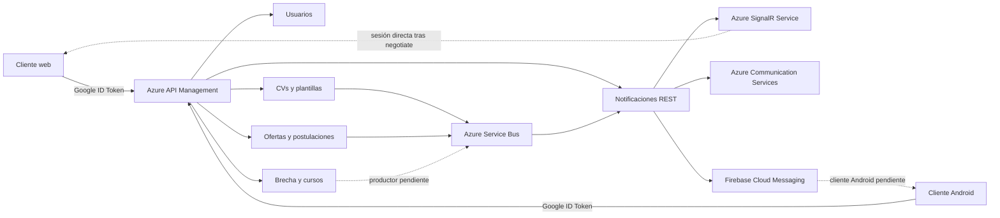

# Arquitectura de integración

Web usa React y Google Identity Services. El cliente HTTP toma `VITE_APIM_BASE_URL` y adjunta el ID token a las solicitudes autenticadas. Android usa Kotlin, Jetpack Compose y Retrofit. Su configuración `APIM_BASE_URL` selecciona el gateway. El código de Android incluye un flujo de instantánea de habilidades y las operaciones REST de historial, directorio y lectura de Notificaciones. [Web](https://github.com/SoftwareDesignTEC/cvexpert-web/tree/b2c34021b3532ff8c14481c02c70b92d2be903f7/apps/web) · [Android](https://github.com/SoftwareDesignTEC/cvexpert-mobile/tree/4b88785b32958491eb7c94146e1523255d2d367b/app)

Las flechas de APIM representan el enrutamiento de la arquitectura. La [matriz](matriz-trazabilidad.md) distingue los mapeos registrados de la evidencia de ejecución. Los canales externos y los publicadores dependen de configuración. Consulte [Notificaciones](notificaciones.md) para los disparadores, el contrato de mensajes y la integración pendiente de Brecha.

## Propiedad de datos

| Dominio | Persistencia respaldada por el repositorio |
| --- | --- |
| Usuarios | Spring Data MongoDB para perfil y sesiones. El README describe MongoDB local y configuración compatible en Azure. |
| CVs | MongoDB para documentos de CV, plantillas y registro de uso de las operaciones de asistencia de redacción. |
| Ofertas y postulaciones | PostgreSQL para ofertas, postulaciones y alertas. Los adaptadores de persistencia están separados de las reglas del dominio. |
| Brecha y cursos | PostgreSQL para catálogo, requisitos de mercado e instantáneas de habilidades. El identificador de la instantánea se deriva del sujeto autenticado. |
| Notificaciones | MongoDB para historial, directorio, dispositivos y plantillas editadas. |

Las configuraciones y migraciones de cada servicio definen la persistencia. Los commits revisados están en [fuentes.json](../contratos/fuentes.json).

## Despliegue y automatización

- Web tiene un flujo de Azure Static Web Apps. Android tiene un flujo de validación y publicación en GitHub Actions.
- CVs incluye CI y despliegue a App Service con inicio de sesión OIDC. Brecha incluye CI/CD, diagnóstico OIDC y verificaciones del modo de certificado cliente. Notificaciones incluye un workflow de compilación, pruebas y despliegue.
- Ofertas dispone de CI y procedimiento documentado de despliegue a Azure. El README de Usuarios describe App Service, MongoDB y pasos de seguridad pendientes.
- Este repositorio ejecuta validaciones documentales en [GitHub Actions](../.github/workflows/validar-documentacion.yml). El estado de una acción o la existencia de su definición se registra por separado de la evidencia de rutas funcionales.

La [seguridad de APIM](seguridad-apim.md) separa la identidad del cliente, la autorización de administración y la autenticación hacia los backends.
