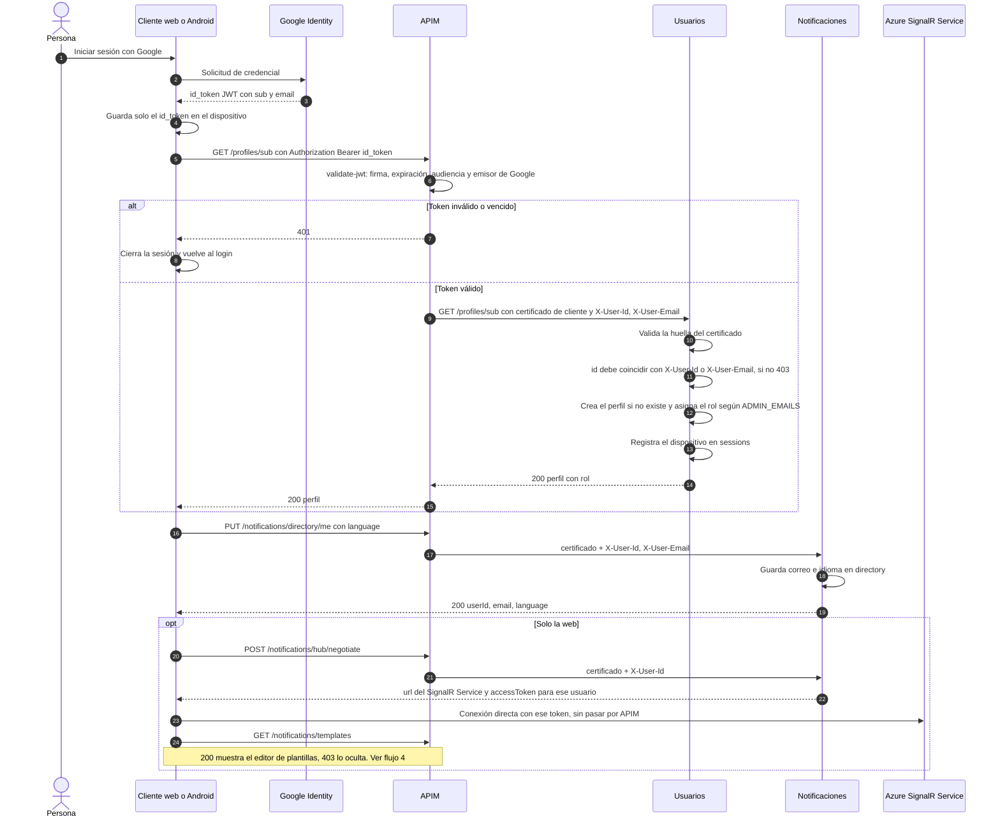
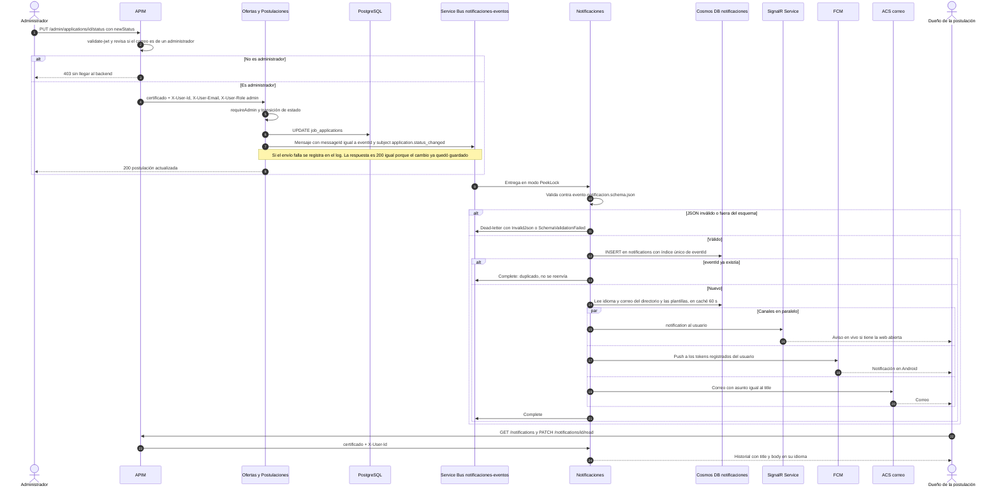
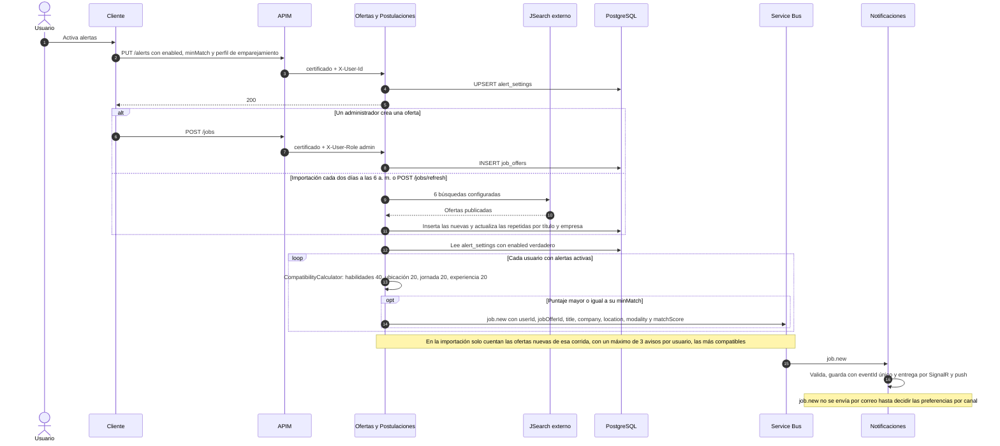
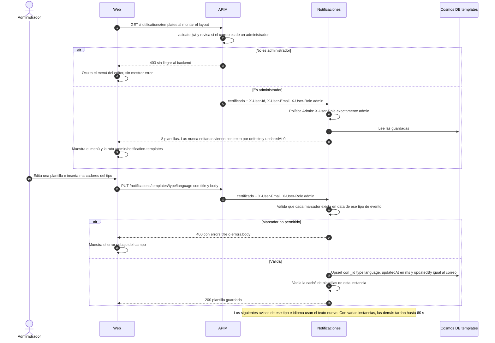

# Flujos principales

Cuatro flujos que cruzan varios servicios. En todos, APIM valida el token, sobrescribe los encabezados `X-User-*` y llama al backend con su certificado de cliente. Cada backend valida ese certificado antes de procesar la llamada. Para no repetirlo en cada diagrama, ese paso se muestra completo en el primero y en los demás se resume como "certificado + X-User-*". El detalle está en [seguridad](seguridad.md).

## 1. Inicio de sesión

La web usa Google Identity Services y Android usa Credential Manager con Google ID. Los dos terminan con el mismo `id_token`, que dura una hora y no se renueva solo.

- El directorio se reenvía al iniciar sesión y cada vez que la persona cambia el idioma. Así Notificaciones sabe a qué correo y en qué idioma escribir, sin preguntarle a Usuarios.
- APIM es de tier Consumption y no soporta WebSockets. Por eso el negotiate pasa por APIM y la conexión en vivo va directo a Azure SignalR Service, con la identidad dentro del token.
- Desde una vista previa de PR, la web redirige el login al dominio de producción, que es el único origen registrado en Google, y vuelve con el token. El destino del retorno se valida contra los dominios del proyecto.

## 2. Cambio de estado de una postulación hasta la notificación

Solo el cambio administrativo publica el evento. Cuando la persona mueve su propia tarjeta (`PUT /applications/{id}`), no se le avisa nada.

- Si Mongo falla, Notificaciones espera 5 s y abandona el mensaje para que Service Bus lo reintente. Al agotar `MaxDeliveryCount`, Service Bus lo pasa a la dead-letter.
- Si un canal falla, se registra con su nombre y los demás siguen. El mensaje se completa igual, porque el aviso ya quedó guardado y se puede consultar por REST.
- El push solo llega si la app registró su token en `POST /notifications/devices`. Android todavía no lo hace en esta fase.
- Si un administrador cambia un estado hacia o desde `interested`, el mensaje no pasa el esquema y termina en la dead-letter (ver [arquitectura](arquitectura.md)).

## 3. Nueva oferta: solo a quien supera su mínimo de compatibilidad

Para recibir avisos, el usuario guarda antes sus alertas. El perfil de emparejamiento lo manda el cliente, porque Ofertas no le pide datos a Usuarios ni a CVs.

- Editar una oferta no vuelve a avisar.
- `POST /jobs/refresh` lo puede pedir cualquier usuario, pero entre una corrida y otra hay que esperar 10 minutos (429 `REFRESH_TOO_SOON`), porque cada corrida gasta 6 consultas del plan de JSearch.

## 4. Edición de plantillas de correo por el administrador

Las plantillas definen el `title` y el `body` de cada tipo de evento en español e inglés: son 8 en total. Se usan para el correo, el push y el historial, porque los textos no se guardan con el aviso, se arman al enviar o al consultar.

- Marcadores válidos por tipo: `{{newStatus}}`, `{{jobTitle}}` y `{{company}}` en `application.status_changed`, `{{title}}` en `cv.generated`, etc. La lista exacta es `NotificationEventValidator.DataFields`, y una prueba la compara con el esquema del evento.
- Los valores se escapan para HTML al armar el correo. `newStatus`, `previousStatus` y `modality` se traducen al idioma del usuario, e `isPaid` sale como "gratis" o "de pago".
- La web es el único cliente con el editor. Android no lo tiene.
