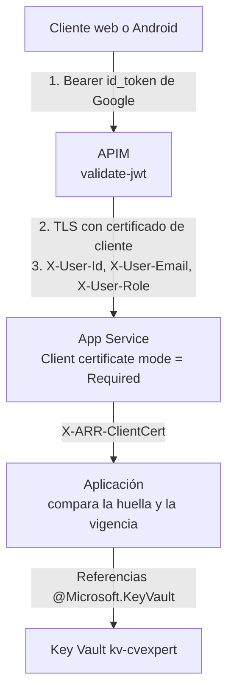

# Seguridad

La seguridad de CVExpert se apoya en dos fronteras. Entre el cliente y APIM, el usuario se identifica con el token de Google. Entre APIM y cada backend, el gateway se identifica con un certificado de cliente. Los backends nunca ven el token: confían en los encabezados de identidad solo porque la llamada trae el certificado de APIM.

El detalle de la configuración consultada en Azure y el inventario de rutas está en [Seguridad de APIM](seguridad-apim.md).

## 1. Token de Google validado en APIM

- Los clientes obtienen un `id_token` de Google y lo envían en `Authorization: Bearer <id_token>` en cada llamada a `https://gabriel-api-management.azure-api.net/api/v1`.
- La política `validate-jwt` de la API `cv-api` usa el descubrimiento OIDC de Google y comprueba la firma, la expiración, la audiencia (el Client ID de OAuth) y los emisores `accounts.google.com` y `https://accounts.google.com`. Si falla, devuelve 401 y el cliente cierra la sesión.
- El token dura una hora y no se renueva solo. En el dispositivo solo se guardan el token y las preferencias de tema e idioma; el resto vive en memoria.
- Las políticas no están versionadas: APIM no tiene repositorio propio. Lo anterior viene del inventario ARM de [seguridad-apim.md](seguridad-apim.md) y de los README de los clientes. El XML vigente de las políticas: **por confirmar**.

## 2. Encabezados de identidad

APIM **sobrescribe** estos encabezados con los datos del token validado. Si un cliente los manda, se pisan.

| Encabezado | Contenido | Cuándo llega |
| --- | --- | --- |
| `X-User-Id` | `sub` de la cuenta de Google, el mismo en todos los servicios | Siempre |
| `X-User-Email` | Correo de la cuenta | Siempre |
| `X-User-Role` | `admin` | Solo en las rutas de administración, y solo si el usuario es administrador |

Así reacciona cada backend cuando falta la identidad:

| Servicio | Sin `X-User-Id` (o sin correo) | Sin rol en una ruta de administración |
| --- | --- | --- |
| Usuarios | 403 | No tiene rutas de administración |
| CVs | 401 (exige `X-User-Id` y `X-User-Email`) | Tiene `require_admin` (403), pero ninguna ruta lo usa |
| Ofertas y Postulaciones | 400 (`Falta la identidad del usuario`) | 403 |
| Brecha y Cursos | 401 `USER_IDENTITY_REQUIRED` | No tiene rutas de administración |
| Notificaciones | 401 (esquema `ApimHeaders`). `PUT` sin `X-User-Email`: 401 | 403 `Se requiere rol de administrador.` |

### De dónde sale el rol

- **Lo que dice el código y los README.** El README de Notificaciones y el inventario de APIM dicen que, en las rutas de administración, APIM compara el correo del token con una lista configurada de administradores. Si coincide, agrega `X-User-Role: admin`. Si no, responde 403 sin llegar al backend. En las escrituras de ofertas (`POST`, `PUT` y `DELETE /jobs`), el inventario del 2026-11-08 muestra que APIM **elimina** `X-User-Role`, así que esas rutas responden 403 incluso a un administrador.
- **Usuarios guarda su propio rol.** Asigna `admin` a los correos de `ADMIN_EMAILS` al crear o leer el perfil, y lo devuelve dentro del perfil. Ningún otro servicio lo consulta.
- **Por confirmar.** Que APIM obtenga el rol consultando a Usuarios y lo guarde en caché 5 minutos no aparece en ningún repositorio ni en el inventario. Si así está configurado, hay que exportar la política para documentarla. Si no, la lista de correos de APIM y `ADMIN_EMAILS` de Usuarios se mantienen por separado y pueden quedar desalineadas.

## 3. Certificado de cliente de APIM hacia los backends

1. APIM presenta el certificado `cvexpert-client-cert` con la política `authentication-certificate` al llamar a cualquier backend. Los cinco comparten el mismo certificado.
2. El App Service, con *Client certificate mode* = `Required`, exige el certificado en el TLS y se lo pasa a la aplicación en `X-ARR-ClientCert` (DER en base64).
3. La aplicación compara la huella SHA-1 con una lista de huellas permitidas, configurada como App Setting. Se aceptan varias separadas por coma, para rotar el certificado sin cortar el servicio.

Validar el encabezado solo es seguro con el modo `Required`. El certificado de APIM es público, y sin ese modo cualquiera podría mandar `X-ARR-ClientCert` a mano.

| Servicio | Componente | Qué valida | Variable | Fuera del chequeo | Respuesta |
| --- | --- | --- | --- | --- | --- |
| Usuarios | `ApimCertificateFilter` (rama `certificado-swagger-postman`, sin fusionar) | Huella y vigencia | `APIM_CERT_THUMBPRINTS` | `/actuator/health` | 403 |
| CVs | Middleware `require_apim_client_cert` en `app/main.py` | **Solo la huella**, sin vigencia | `APIM_CERT_THUMBPRINTS` | `/health` | 403 |
| Ofertas y Postulaciones | `ApimCertificateFilter` | Huella y vigencia | `APIM_CERT_THUMBPRINT` | `/actuator/health` | 403 `INVALID_CLIENT_CERTIFICATE` |
| Brecha y Cursos | `createApimCertificateGuard` | DER canónico estricto, huella y vigencia | `APIM_CERT_THUMBPRINTS` | `/health` (en la aplicación; en App Service no hay exclusiones) | 403 `APIM_CERTIFICATE_REQUIRED`, o 503 si falta la configuración |
| Notificaciones | `ApimCertificateMiddleware` | Huella y vigencia | `Apim__CertificateThumbprint` | `/health` | 403 |

- En todos, menos Brecha, si la variable está vacía no se valida nada. Así se trabaja en local y en las pruebas. Brecha falla cerrado: solo se puede saltar el chequeo con `APIM_ALLOW_INSECURE_LOCAL=true` fuera de Azure.
- **Por confirmar:** el modo de certificado efectivo de cada App Service. En la consulta registrada en [seguridad-apim.md](seguridad-apim.md), CVs tenía `clientCertEnabled` desactivado. Notificaciones documenta pruebas de rechazo hechas el 2026-11-06.
- Las huellas no se copian en esta documentación. Se configuran como App Settings normales, porque no son secretas, pero identifican el certificado vigente.

## 4. Key Vault

Los secretos de ejecución viven en el Key Vault `kv-cvexpert`. Cada App Service los lee como referencias `@Microsoft.KeyVault(VaultName=kv-cvexpert;SecretName=...)` con su identidad administrada (rol *Key Vault Secrets User*), así que el valor no se copia a la configuración. Los nombres siguen la convención `Servicio--Clave`.

| Servicio | Secretos en Key Vault (solo nombres) | Configuración que no es secreta |
| --- | --- | --- |
| Usuarios | `Usuarios--MongoDbUri` | `ADMIN_EMAILS`, `APIM_CERT_THUMBPRINTS` |
| CVs | **Por confirmar** (lee `MONGODB_URI`, `GEMINI_API_KEY`, `SERVICE_BUS_CONNECTION_STRING` y `AZURE_STORAGE_CONNECTION_STRING`) | `APIM_CERT_THUMBPRINTS`, `LLM_PROVIDER` |
| Ofertas y Postulaciones | `ServiceBus--SendConnectionString`, `Ofertas--JSearchApiKey` | `APIM_CERT_THUMBPRINT`. `DB_URL`, `DB_USER` y `DB_PASSWORD` están como variables cifradas del App Service, no en Key Vault |
| Brecha y Cursos | **Por confirmar** (lee `PGHOST`, `PGUSER`, `PGPASSWORD`, etc.) | `APIM_CERT_THUMBPRINTS`, `SKILLS_GAP_MARKET_KEY` |
| Notificaciones | `Mongo--ConnectionString`, `ServiceBus--ConnectionString`, `Azure--SignalR--ConnectionString`, `Firebase--ServiceAccountJson`, `Acs--ConnectionString` | `Mongo__Database`, `ServiceBus__QueueName`, `Email__Sender`, `Apim__CertificateThumbprint` |

- **Mínimo privilegio en Service Bus:** Ofertas usa una cadena de **solo envío** y Notificaciones una de **solo escucha**, las dos de una política de la cola, nunca `RootManageSharedAccessKey`. Qué política usa CVs: **por confirmar**.
- En local, los secretos van en `.env` (Usuarios, CVs, Ofertas y Brecha), en `dotnet user-secrets` (Notificaciones) o en `local.properties` (Android). Todos están en `.gitignore`.

## 5. Secretos en los pipelines

Ningún repositorio guarda credenciales. Los pipelines se autentican en Azure con OIDC (credencial federada, sin contraseña), salvo Notificaciones y la web.

| Repositorio | Autenticación | Secretos y variables de GitHub |
| --- | --- | --- |
| cvexpert-web | Token de despliegue de Static Web Apps | `secrets.AZURE_STATIC_WEB_APPS_API_TOKEN_…`. `vars.APIM_BASE_URL` y `vars.GOOGLE_WEB_CLIENT_ID` se inyectan en la compilación |
| cvexpert-mobile | Cuenta de servicio de Firebase | Secrets `RELEASE_KEYSTORE_BASE64`, `RELEASE_KEYSTORE_PASSWORD`, `RELEASE_KEY_ALIAS`, `RELEASE_KEY_PASSWORD` y `FIREBASE_SERVICE_CREDENTIALS`. Variables `APIM_BASE_URL`, `GOOGLE_WEB_CLIENT_ID`, `FIREBASE_APP_ID` y `NOTIFICATIONS_ENABLED` |
| cvexpert-ms-usuarios | OIDC (`gh-actions-cvexpert-ms-usuarios`, `refs/heads/main`) | `AZURE_CLIENT_ID`, `AZURE_TENANT_ID` y `AZURE_SUBSCRIPTION_ID` (son identificadores, no contraseñas) |
| cvexpert-ms-cvs | OIDC (`gh-actions-cvexpert-ms-cvs`, environment `production`), rol *Website Contributor* solo sobre su App Service | Los mismos tres identificadores |
| cvexpert-ms-ofertas-postulaciones | OIDC con la identidad administrada `id-github-ofertas`, solo `main`, *Website Contributor* solo sobre la app | Los tres identificadores y `vars.AZURE_WEBAPP_NAME` |
| cvexpert-ms-brecha-cursos | OIDC en el environment `azure-production`, con identidad de despliegue distinta de la de ejecución | Variables de environment `AZURE_CLIENT_ID`, `AZURE_TENANT_ID` y `AZURE_SUBSCRIPTION_ID`. Variables de repo `ENABLE_AZURE_DEPLOY` y `AZURE_DEPLOY_RUNNER` |
| cvexpert-ms-notificaciones | Publish profile del App Service | `AZURE_WEBAPP_PUBLISH_PROFILE`, el único secreto. Es el único backend que usa autenticación básica de SCM |
| cvexpert-docs | No despliega | Ninguno. El CI busca credenciales accidentales en cada PR con `scripts/validar_cobertura.py` |

## 6. Rama `main` protegida

Todo cambio entra por pull request revisado por otro integrante. No se hace push directo a `main`.

- Lo declaran los README de Usuarios, CVs, Ofertas, Notificaciones y Android. En Ofertas, el check `pruebas` es obligatorio para unir un PR.
- Brecha indica que el check `CI` debe configurarse como obligatorio en `develop` y `main`, pero el workflow no crea esa regla.
- **Por confirmar** en GitHub (Settings → Branches): la regla efectiva de cada repositorio, en especial `cvexpert-web`, `cvexpert-docs` y `cvexpert-ms-brecha-cursos`, cuyos README no lo dicen.

## Riesgos conocidos

- **Certificado compartido.** Los cinco backends aceptan el mismo certificado. Quien tenga su clave privada podría llamar directo a cualquiera y falsificar la identidad.
- **Backends públicos.** APIM es Consumption y no tiene red privada, así que los App Services aceptan tráfico público. Solo los protege el modo `Required` más la huella.
- **CVs** no revisa la vigencia del certificado, y su modo de App Service está **por confirmar**.
- **Usuarios** depende de una rama sin fusionar. Si se desplegara el código de `main`, la aplicación no validaría la huella y solo quedaría el modo `Required` del App Service.
